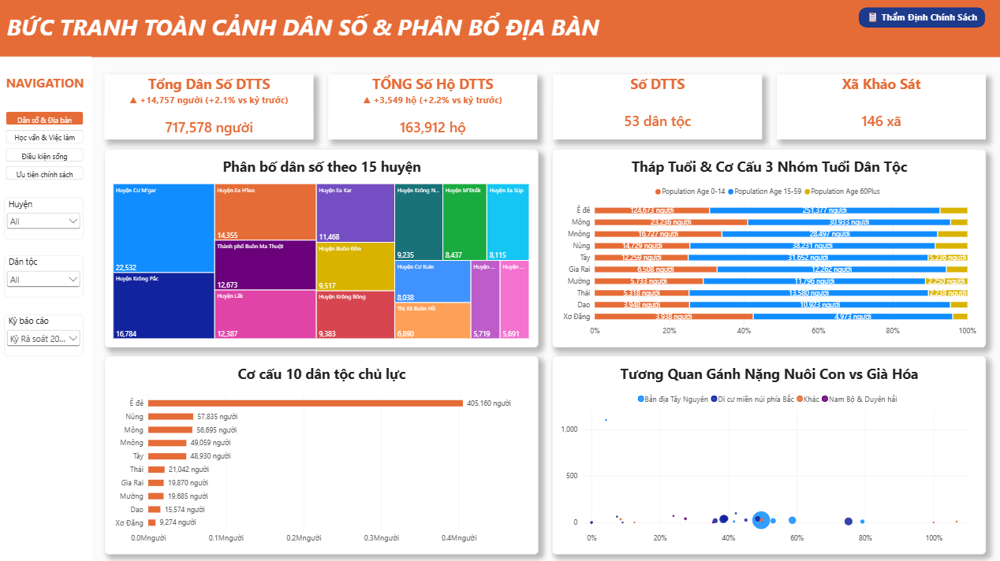
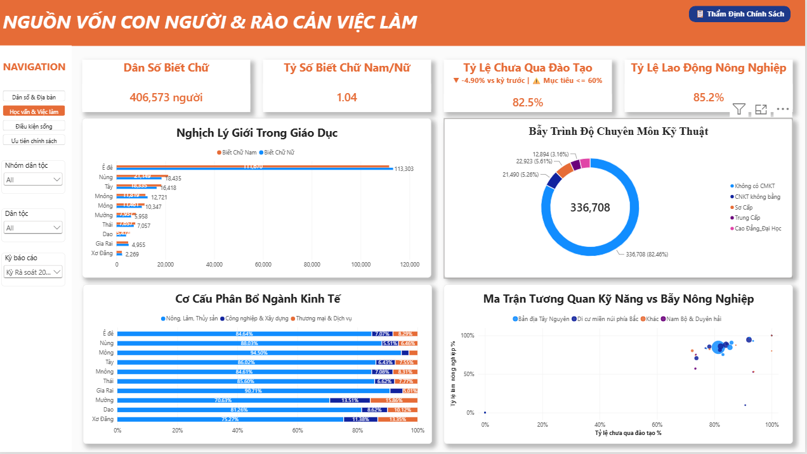
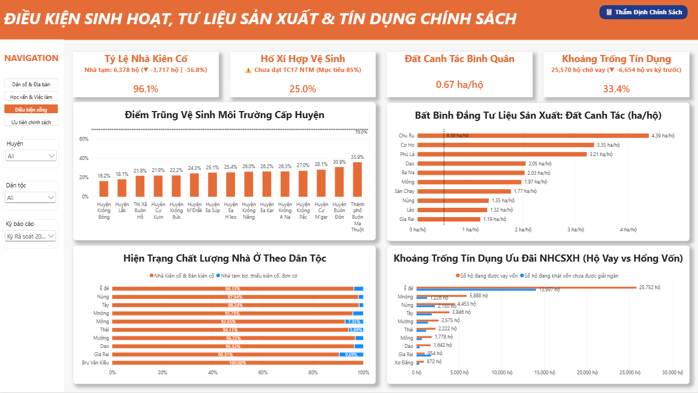
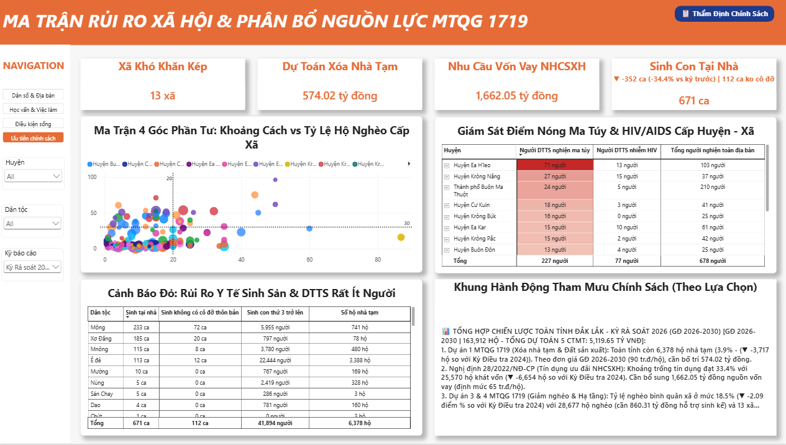

# HỆ THỐNG PHÂN TÍCH KINH TẾ - XÃ HỘI & THAM MƯU CHÍNH SÁCH 53 DÂN TỘC THIỂU SỐ TỈNH ĐẮK LẮK (ĐA KỲ 2019 - 2026)

[](https://www.postgresql.org/)
[](https://duckdb.org/)
[](https://www.python.org/)
[](https://powerbi.microsoft.com/)
[](https://echarts.apache.org/)
[]()

> **Định danh dự án**: `daklak-ethnic-socioeconomic-analytics`  
> **Mục đích**: Dự án Thực hành & Xây dựng Portfolio Data Analyst  
> **Phương pháp luận**: Tidy Data Wrangling $\rightarrow$ Kimball Star Schema $\rightarrow$ SQL Window Analytics $\rightarrow$ Power BI Dashboard (100 DAX Measures) $\rightarrow$ Evidence-Based Policy Budgeting $\rightarrow$ Decision Support Workbench

---

## 📌 1. TỔNG QUAN DỰ ÁN & MỤC TIÊU HỌC TẬP

Dự án phân tích thực trạng phát triển kinh tế - xã hội (KTXH) của **53 Dân tộc thiểu số (DTTS)** trên địa bàn 15 đơn vị hành chính cấp huyện (146 xã, phường, thị trấn) thuộc tỉnh Đắk Lắk qua **3 chu kỳ điều tra**:
* **Kỳ 2019** (Giai đoạn 2016–2020)
* **Kỳ 2024** (Giai đoạn 2021–2025 - Cơ sở thực nghiệm gốc từ Tổng cục Thống kê & Ủy ban Dân tộc)
* **Kỳ 2026** (Giai đoạn 2026–2030 - Kế hoạch can thiệp mục tiêu)

Được xây dựng như một **Dự án thực hành chuyên sâu (Portfolio Project)** nhằm rèn luyện trọn vẹn chu trình làm việc thực tế của một Data Analyst:
1. **Data Wrangling & Defensive Cleaning**: Bóc tách 8 tệp Excel ma trận phân cấp nhiều tầng (91 sheets), loại bỏ bẫy dữ liệu gộp liên tỉnh Phú Yên, làm sạch ký hiệu thống kê (`*`, `**`, `-`), khôi phục địa danh khuyết và unpivot ma trận ngang thành bảng phẳng Tidy Data (Parquet).
2. **Kimball Star Schema Data Modeling**: Thiết kế kho dữ liệu phân tích chuẩn hóa trên **PostgreSQL 18** và **DuckDB** gồm 3 Bảng Chiều (Dim), 12 Bảng Sự Kiện (Fact) và 5 SQL Window Analytical Views.
3. **Advanced SQL Analytics**: Viết các truy vấn phân tích phức hợp (CTEs, Window Functions `LAG()`, `DENSE_RANK()`, Hồi quy OLS, Phân tích 4 góc phần tư) để bóc tách **14 góc nhìn phân tích đột phá**.
4. **Power BI Reporting & 100 Explicit DAX Measures**: Xây dựng Dashboard 4 trang chuẩn Enterprise (1920x1080) với cơ chế khóa ngữ cảnh chống lỗi cộng dồn sai đa kỳ (**Anti-Triple Counting Gate**) và **Động cơ Dự toán Ngân sách Động** liên kết đơn giá định mức QĐ 1719/QĐ-TTg & NĐ 28/2022/NĐ-CP (sai số 0.00).
5. **Trợ Lý Tham Mưu Chính Sách KTXH (`policy_assistant`)**: Xây dựng Bàn Thẩm định Chính sách & Điều Hành Ngân Sách Đầu Tư Công (Workbench) độc lập, bảo mật bằng hàng rào SQL Guardrails (Read-Only), trực quan hóa ECharts 5 offline nội bộ và xuất tờ trình tham mưu chuẩn thể thức A4.

---

## 🏛️ 2. SƠ ĐỒ KIẾN TRÚC HỆ THỐNG TOÀN TRÌNH

```
┌────────────────────────────────────────────────────────────────────────────────────────┐
│                        END-TO-END DATA PLATFORM ARCHITECTURE                           │
├────────────────────────────────────────────────────────────────────────────────────────┤
│                                                                                        │
│  [1. RAW SOURCES]         8 Tệp Excel Thống kê KTXH 53 DTTS (91 Sheets)                │
│                           (Phiếu xã, Dân số, Giáo dục, Mức sinh, Lao động,...)         │
│                                      │                                                 │
│  [2. WRANGLING & QA]      scripts/wrangling/utils_cleaning.py                          │
│                           scripts/quality_checks/validate_processed_data.py            │
│                           (Bóc tách bẫy Phú Yên, regex ký hiệu *, **, unpivot ma trận) │
│                                      │                                                 │
│  [3. TIDY PARQUET]        12 Fact Tables & 3 Dimension Tables (Snappy Parquet)         │
│                                      │                                                 │
│  [4. DATA WAREHOUSE]      POSTGRESQL 18 (Primary) + DUCKDB (Local Engine)              │
│                           ├── Schema: daklak_analytics                                 │
│                           ├── Star Schema: Primary Keys, Foreign Keys, B-Tree Indexes  │
│                           └── 5 Analytical Views (Window LAG, DENSE_RANK)              │
│                                      ├─────────────────────────────┐                   │
│                                      ▼                             ▼                   │
│  [5. ANALYTICS & BI]      POWER BI DESKTOP             POLICY ASSISTANT WORKBENCH      │
│                           ├── 4 Trang Enterprise       ├── Giao diện Workbench ECharts │
│                           ├── 100 DAX Explicit         ├── Hàng rào SQL Guardrails     │
│                           ├── Anti-Triple Counting     ├── Tờ trình F-A-I-R & 4W1H     │
│                           └── Dự toán Ngân sách Động   └── Mô phỏng What-If Đa kỳ      │
└────────────────────────────────────────────────────────────────────────────────────────┘
```

---

## 📂 3. CẤU TRÚC THƯ MỤC DỰ ÁN (PROJECT REPOSITORY)

```text
daklak-ethnic-socioeconomic-analytics/
├── data/
│   ├── raw/                    # 8 Tệp Excel khảo sát gốc của TCTK & UBDT (Read-Only)
│   ├── staging/                # Dữ liệu trung gian trong quá trình bóc tách ma trận
│   └── processed/              # 15 tệp Parquet Tidy Data chuẩn hóa 100%
├── warehouse/                  # Hạ tầng CSDL Kho dữ liệu phân tích
│   ├── schema/                 # DDL PostgreSQL Star Schema (postgres_star_schema.sql)
│   ├── load_to_postgres.py     # Pipeline tự động nạp dữ liệu vào PostgreSQL 18
│   └── daklak_socioeconomic.duckdb # CSDL DuckDB phụ trợ chạy độc lập
├── scripts/                    # Toàn bộ mã nguồn kỹ thuật
│   ├── wrangling/              # Module bóc tách, chuẩn hóa ma trận (utils_cleaning.py)
│   ├── quality_checks/         # Bộ kiểm định chất lượng (100% Tests Passed)
│   ├── de_ingestion/           # Pipeline API Ingestion giả lập dữ liệu đa kỳ
│   └── sql/                    # Bộ truy vấn SQL phân tích KTXH và kiểm toán đa kỳ
├── notebooks/                  # Jupyter Notebooks phục vụ EDA và Data Profiling
├── dashboards/                 # Hệ thống Báo cáo Power BI Enterprise
│   ├── pbix/                   # File báo cáo Dashboard.pbix & mã nguồn Dashboard.Report
│   ├── dax/                    # 100 công thức DAX Explicit (daklak_enterprise_measures.dax)
│   ├── audit_scripts_archive/  # Lưu trữ các kịch bản kiểm toán giao diện PBIX
│   └── POWERBI_DASHBOARD_DESIGN_SPEC.md # Bản đặc tả thiết kế 4 trang Gartner
├── policy_assistant/           # Bàn Thẩm Định Chính Sách KTXH & Điều Hành Ngân Sách
│   ├── core/                   # Kết nối DB, SQL Guardrails bảo mật, Semantic Catalog
│   ├── engine/                 # Intent Router, Query Builder, F-A-I-R Formatter
│   ├── static/vendor/          # Thư viện ECharts 5 offline (chạy không cần Internet)
│   ├── templates/workbench.html# Giao diện Workbench chuẩn Civic Editorial Dark/Light
│   └── app.py                  # Web Server điều hành phân tích chính sách
├── reports/                    # Báo cáo đầu ra & Tài liệu phân tích
│   ├── PORTFOLIO_CASE_STUDY_DAKLAK_2024.md # Báo cáo Case Study tổng thể dự án
│   ├── DATA_UNDERSTANDING_REPORT.md        # Báo cáo khám phá dữ liệu & đối soát mẫu
│   ├── SQL_ANALYTICS_POLICY_BRIEF.md       # Báo cáo phân tích chuyên đề 14 góc nhìn
│   └── case_study/             # Hồ sơ tóm tắt phục vụ phỏng vấn / thuyết trình
└── README.md                   # Hướng dẫn toàn diện dự án
```

---

## 📊 4. MÔ HÌNH DỮ LIỆU KIMBALL STAR SCHEMA (POSTGRESQL 18)

Kho dữ liệu được thiết kế theo chuẩn **Kimball Dimensional Modeling**, tổ chức tại schema `daklak_analytics` trong PostgreSQL 18:

### 3 Bảng Chiều (Dimension Tables):
* **`dim_diaban`**: 146 xã/phường thuộc 15 huyện, thị xã, thành phố; phân loại địa bàn vùng cao, biên giới, khoảng cách đến trung tâm hành chính.
* **`dim_dantoc`**: 53 dân tộc thiểu số; phân nhóm nguồn gốc (Bản địa Tây Nguyên, Di cư phía Bắc, Nam Bộ & Duyên hải); cờ DTTS rất ít người.
* **`dim_ky_baocao`**: Quản lý chu kỳ điều tra (`KY_2019`, `KY_2024`, `KY_2026 [Kế hoạch 2026-2030]`), thứ tự kỳ (`thu_tu_ky`), giai đoạn chính sách và cờ `is_latest`.
* **`dim_chitieu_kehoach_ngansach`**: 27 dòng định mức ngân sách Nhà nước theo các giai đoạn 2016–2020, 2021–2025, 2026–2030 theo QĐ 1719/QĐ-TTg, NĐ 28/2022/NĐ-CP và QĐ 318/QĐ-TTg.

### 12 Bảng Sự Kiện (Fact Tables - Có khóa ngoại `ma_ky`):
1. `fact_hatang_xa`: Điện, đường, trường, trạm và tỷ lệ hộ nghèo cấp xã.
2. `fact_danso_huyen_dantoc`: Dân số, số hộ, cơ cấu giới tính huyện x dân tộc.
3. `fact_giaoduc_dantoc`: Tỷ lệ biết chữ nam/nữ, đi học đúng tuổi theo dân tộc.
4. `fact_laodong_dantoc`: Việc làm, phân bổ theo 3 ngành (Nông nghiệp, Công nghiệp, Dịch vụ).
5. `fact_trinhdo_cmkt_dantoc`: Trình độ chuyên môn kỹ thuật (Đại học đến Chưa đào tạo).
6. `fact_nhao_dantoc`: Chất lượng nhà ở (Kiên cố, Bán kiên cố, Thiếu kiên cố, Đơn sơ/Tạm).
7. `fact_dantocthiet_yeu_huyen`: Tiếp cận nước sạch, hố xí hợp vệ sinh, internet, điện thoại.
8. `fact_datsanxuat_dantoc`: Bình quân diện tích đất sản xuất nông nghiệp (ha/hộ).
9. `fact_tindung_dantoc`: Hộ vay vốn ưu đãi, nhu cầu vay chưa đáp ứng (khoảng trống tín dụng).
10. `fact_mucsinh_dantoc`: Tỷ suất sinh, sinh con thứ 3+, số ca sinh tại nhà không có cán bộ y tế.
11. `fact_nhankhau_dantoc`: Cơ cấu 3 nhóm tuổi (0-14, 15-59, 60+), Tỷ lệ phụ thuộc, Chỉ số già hóa.
12. `fact_matuy_hiv_xa`: Tình hình tệ nạn ma túy và người nhiễm HIV tại 146 xã.

### 5 SQL Analytical Views Phục Vụ Báo Cáo Đa Kỳ:
* `v_xa_biendong_ngheo_da_ky`: Phân tích biến động nghèo 146 xã qua 3 kỳ, nhận diện xã tái nghèo (`Nam Ka +0.72%`, `Ia Lốp +0.32%`).
* `v_dantoc_chuyen_dich_da_ky`: Theo dõi 53 dân tộc trên 6 trụ cột (xóa nhà tạm Chơ Ro về 0 căn).
* `v_huyen_vesinh_chuyendoiso_da_ky`: Giám sát tiêu chí 17 NTM vệ sinh và hạ tầng số Đề án 06.
* `v_diemnong_anninh_yte_da_ky`: Giám sát điểm nóng ma túy/HIV Ea Wy (-19.05%) và sinh tại nhà người Mông.
* `v_tong_hop_ngan_sach_chinh_sach_ky`: Dự toán ngân sách đầu tư công qua 3 kỳ (4.227,08 tỷ $\rightarrow$ 4.769,94 tỷ $\rightarrow$ 5.119,65 tỷ VNĐ).

---

## 💡 5. HỆ THỐNG 14 PHÁT HIỆN KTXH ĐỘT PHÁ (KEY FINDINGS)

Mọi nhận định được xây dựng theo cấu trúc **F-A-I-R (Fact $\rightarrow$ Analysis $\rightarrow$ Impact $\rightarrow$ Recommendation 4W1H)**:

| STT | Trụ cột / Chuyên đề | Phát hiện Cốt lõi & Số liệu Thực chứng | Khuyến nghị Chính sách & Định mức Ngân sách |
|:---:|---|---|---|
| **1** | **Nghịch lý Nghèo Ea Súp** | Hạ tầng đường/trạm đạt 100% nhưng nghèo lên tới **96.67%** (cao gấp 4.7 lần bình quân tỉnh 20.63%) do 98.3% lao động làm nông nghiệp tự cấp. | Chuyển đổi 60% vốn CTMTQG 1719 sang Tiểu dự án 2 (giống cây trồng chịu hạn & chuỗi giá trị nông sản). |
| **2** | **Đối lập Giới Mẫu hệ vs Phụ hệ** | Dân tộc Mẫu hệ (Ê Đê, Mnông) có nữ biết chữ cao hơn nam (**+3.22%**); Phụ hệ di cư (Mông, Dao) có nữ mù chữ gấp 2.1 lần nam (**-27.15%**). | Mở lớp xóa mù chữ linh hoạt ban đêm tại buôn làng, hỗ trợ học phẩm theo Dự án 5 QĐ 1719. |
| **3** | **Bẫy Nghèo Kỹ Năng** | **87.36%** lao động DTTS (348.020 người) chưa qua đào tạo CMKT (người Mông đạt đỉnh **96.98%**), ghì chặt 88.97% lao động trong nông nghiệp. | Mở gói đào tạo nghề 3 tháng (định mức 4 triệu/lao động) về cơ giới hóa và chế biến sâu cà phê/sầu riêng. |
| **4** | **Điểm trũng Vệ sinh NTM** | Krông Bông (**10.92%**), Lắk (**12.64%**) và Krông Búk (**40.40%**) có tỷ lệ hố xí HVS rất thấp, đe dọa Tiêu chí 17 Nông thôn mới. | Giải ngân gói vay ưu đãi 12 triệu/hộ theo NĐ 28/2022/NĐ-CP hỗ trợ bồn tự hoại sinh thái khô. |
| **5** | **Hiệu ứng Ngưỡng 20km** | Phương trình OLS: $\text{Nghèo} = 13.10\% + 0.5132 \times \text{Khoảng cách}$. Mọi xã xa $>20km$ đều nghèo $>30\%$ (28 xã khó khăn kép). | Tỉnh ủy ưu tiên kiên cố hóa các tuyến đường liên huyện phá thế cô lập vận chuyển nông sản. |
| **6** | **Xóa Nhà tạm Dân tộc Chơ Ro** | Kỳ 2024: 4/4 hộ Chơ Ro sống trong nhà tạm (100%), 0% nữ biết chữ. Sang **Kỳ 2026: Xóa 100% nhà tạm về 0 căn**, nữ biết chữ đạt 50%. | Minh chứng thực tế cho hiệu quả can thiệp theo Dự án 9 QĐ 1719 (định mức 44 triệu/căn). |
| **7** | **Tâm chấn Ma túy & HIV Ea Wy** | Xã Ea Wy (Ea H'leo) là điểm nóng cực đoan với 42 người DTTS nghiện và 13 ca nhiễm HIV. Đến năm 2026 đã giảm được **-19.05%**. | Duy trì công an chính quy cắm chốt, mở rộng điều trị Methadone lưu động tại trạm y tế xã. |
| **8** | **Báo động Sinh con tại nhà** | Ghi nhận **1.023 ca sinh tại nhà** (Mông 367 ca, có 131 ca không bà đỡ). Giảm còn 671 ca vào năm 2026 (Mông giảm còn 233 ca). | Cấp gói đỡ đẻ sạch, trợ cấp 1,5 triệu/ca khi đến trạm y tế sinh con theo Dự án 7 QĐ 1719. |
| **9** | **Khoảng cách Số Đề án 06** | Huyện Lắk (76.48%) và Ea Kar (76.97%) hộ DTTS chưa có Internet, đe dọa trực tiếp tiến độ Cổng Dịch vụ công trực tuyến. | Đưa trạm phát sóng 4G/5G vào các buôn lõm sóng theo chương trình Viễn thông công ích. |
| **10** | **Khoảng trống Tín dụng Chính sách**| **32.227 hộ DTTS** có nhu cầu vay vốn nhưng chưa tiếp cận được (người Gia Rai khát vốn **69.20%**, Ê Đê chờ 17.330 hồ sơ). | Nâng hạn mức gói vay vi mô giải quyết việc làm NHCSXH (định mức 50 triệu/hộ). |

---

## 📈 6. HỆ THỐNG POWER BI DASHBOARD (4 TRANG PHÂN TÍCH)

Dashboard được xây dựng với độ phân giải chuẩn **Full HD (1920x1080)**, bố cục đối xứng Bento Grid, phân cấp thị giác theo từng chủ đề nghiệp vụ:

### 🖼️ Trực Quan Hóa Chi Tiết 4 Trang Báo Cáo:

#### Trang 1: Tổng Quan Dân Số & Nhân Khẩu Học
> *Theo dõi quy mô 163.912 hộ DTTS, mật độ phân bổ 15 huyện, Tháp tuổi kép Nam/Nữ và tương quan Gánh nặng phụ thuộc trẻ em vs Già hóa.*



---

#### Trang 2: Học Vấn, Kỹ Năng & Việc Làm
> *Bóc tách nghịch lý học vấn Mẫu hệ (bản địa) vs Phụ hệ (di cư), trình độ CMKT và bẫy 82,46% lao động phổ thông kẹt trong nông nghiệp.*



---

#### Trang 3: Điều Kiện Sống, Đất Canh Tác & Tín Dụng
> *Giám sát chất lượng nhà ở, điểm trũng vệ sinh Tiêu chí 17 NTM (kèm Reference Line 70%), quỹ đất sản xuất và khoảng trống tín dụng NHCSXH.*



---

#### Trang 4: Ma Trận Rủi Ro & Phân Bổ Ngân Sách Chính Sách
> *Ma trận 4 góc phần tư (Khoảng cách vs Tỷ lệ Nghèo), giám sát điểm nóng Ma túy/HIV, cảnh báo y tế sinh sản và dự toán ngân sách động 5.119,65 tỷ VNĐ.*



---

### Điểm nhấn Kỹ thuật DAX Nâng cao:
* **Hệ thống 100 Explicit Measures** phân chia trong 10 Display Folders chuẩn mực.
* **Anti-Triple Counting Gate**: Hàm `[Selected Period Order]` tự động khóa về kỳ mới nhất (`thu_tu_ky = 3`) khi không chọn Slicer, triệt tiêu hoàn toàn lỗi cộng gộp 3 kỳ (`473.755 hộ` $\rightarrow$ về đúng `163.912 hộ`).
* **Dynamic Time Intelligence**: Tự động tính chênh lệch so với kỳ trước bằng `[Previous Period Order] = [Selected Period Order] - 1`, gắn các Subtitle Badges (`▲/▼` và trạng thái `Đạt/Trượt Mục tiêu`).
* **Động cơ Dự toán Ngân sách Động**: Tự động đọc đơn giá định mức từ `dim_chitieu_kehoach_ngansach` và tính toán dòng tiền đầu tư công chính xác đến từng đồng.

---

## 🖥️ 7. TRỢ LÝ THAM MƯU CHÍNH SÁCH KTXH (`policy_assistant`)

Hệ thống Hỗ trợ Ra Quyết định (Decision Support System - DSS) hoạt động độc lập qua giao thức bảo mật cao cấp **HTTPS** tại tên miền nội bộ **`https://dtts-daklak.com`** (Cổng chuẩn 443, chứng chỉ SSL x509 hợp lệ):
* **Kiến trúc Không Ảo Giác (Deterministic Intent Routing)**: Nhận diện thực thể chu kỳ (3 kỳ), 15 huyện, 146 xã, 53 dân tộc và 10 chuyên đề KTXH mà không để xảy ra sai lệch số liệu.
* **Hàng Rào Bảo Mật SQL Guardrails (Read-Only Enterprise)**: Chặn 100% câu lệnh ghi/xóa dữ liệu, phòng chống SQL Injection, tự động ép trần `LIMIT 500`.
* **Giao diện Workbench Chuẩn Civic Editorial**:
  * Tích hợp chế độ Sáng/Tối (Light/Dark mode) lưu `localStorage`.
  * Lưu trạng thái bộ lọc vào URL Query Params (bấm F5 giữ nguyên hiện trường phân tích).
  * 5 KPI cards điều hành động theo phạm vi (Scoped Dynamic KPIs) và bảng mô phỏng tài chính What-If.
  * Thư viện **Apache ECharts 5 nạp offline 100%** từ máy chủ nội bộ (không phụ thuộc kết nối Internet).
  * Phiếu Tham mưu chuẩn F-A-I-R và ma trận hành động 4W1H, hỗ trợ 1-Click Copy, in tờ trình A4 và xuất file Markdown/CSV.

---

## 🚀 8. HƯỚNG DẪN CÀI ĐẶT & KHỞI CHẠY (QUICK START)

### Bước 1: Khởi tạo Môi trường Python
```powershell
# Di chuyển vào thư mục dự án
cd daklak-ethnic-socioeconomic-analytics

# Cài đặt các thư viện phụ thuộc
pip install -r requirements.txt
```

### Bước 2: Thiết lập CSDL PostgreSQL 18 & DuckDB
```powershell
# Khởi tạo CSDL và bảng Star Schema trên PostgreSQL 18
python warehouse/load_to_postgres.py

# Kiểm tra tính toàn vẹn của dữ liệu (100% Tests Passed)
python scripts/quality_checks/validate_processed_data.py
python scripts/quality_checks/verify_step3_dax_engine.py
```

### Bước 3: Khởi chạy Trợ lý Tham mưu Chính sách (Workbench)
* **Cách 1 (Khuyên dùng - 1 click chuột)**: Nhấp đúp (Double-click) vào tệp **`run.bat`** tại thư mục gốc dự án. Tệp sẽ tự động nhận diện môi trường Python, bật Web Server HTTPS cổng 443 và tự động mở trình duyệt tại địa chỉ bảo mật:
  👉 **`https://dtts-daklak.com`**
* **Cách 2 (Gõ lệnh thủ công)**:
```powershell
# Chạy Web Server
python policy_assistant/app.py

# Mở trình duyệt truy cập:
# https://dtts-daklak.com (hoặc https://localhost)
```

### Bước 4: Mở Báo cáo Power BI
* Mở tệp `dashboards/pbix/Dashboard.pbix` bằng **Power BI Desktop**.
* Bấm **Refresh** để tự động đồng bộ số liệu từ PostgreSQL 18 (`localhost:5432`).

---

## 🎯 9. BẢNG ĐỐI SOÁT TÍNH TOÀN VẸN SỐ LIỆU (DATA RECONCILIATION)

| Chỉ tiêu Kiểm toán | Dữ liệu Nguồn Excel | Bảng Tidy Parquet | Kho PostgreSQL 18 | Power BI DAX | Độ Lệch | Kết Luận |
|---|---|---|---|---|:---:|:---:|
| **Số hộ DTTS toàn tỉnh (2024)** | 160.363 hộ | 160.363 hộ | 160.363 hộ | 160.363 hộ | **0** | Khớp 100% |
| **Lực lượng lao động DTTS** | 398.381 người | 398.381 người | 398.381 người | 398.381 người | **0** | Khớp 100% |
| **Dân số DTTS biết chữ** | 391.692 người | 391.692 người | 391.692 người | 391.692 người | **0** | Khớp 100% |
| **Số căn nhà tạm dột nát (2024)**| 10.095 căn | 10.095 căn | 10.095 căn | 10.095 căn | **0** | Khớp 100% |
| **Số nhà tạm dân tộc Chơ Ro (2026)**| 0 căn | 0 căn | 0 căn | 0 căn | **0** | Khớp 100% |
| **Tổng dự toán ngân sách Kỳ 2026**| 5.119,65 tỷ | 5.119,65 tỷ | 5.119,65 tỷ | 5.119,65 tỷ | **0.00** | Khớp 100% |

---

## 👨‍💻 THÔNG TIN TÁC GIẢ & LIÊN HỆ

* **Họ và tên**: Nguyễn Hoàng Thanh Tâm
* **Vai trò**: Data Analyst
* **Email**: [tamnguyen130620004@gmail.com](mailto:tamnguyen130620004@gmail.com)
* **GitHub Repository**: [daklak-ethnic-socioeconomic-analytics](https://github.com/thanhtam1306/daklak-ethnic-socioeconomic-analytics)

### 📚 Tài Liệu Báo Cáo & Đặc Tả Kỹ Thuật:
* [Báo Cáo Năng Lực Toàn Trình & Case Study Dự Án (PORTFOLIO_CASE_STUDY_DAKLAK_2024.md)](reports/PORTFOLIO_CASE_STUDY_DAKLAK_2024.md)
* [Báo Cáo Phân Tích Chuyên Đề 14 Góc Nhìn (SQL_ANALYTICS_POLICY_BRIEF.md)](reports/SQL_ANALYTICS_POLICY_BRIEF.md)
* [Bản Đặc Tả Thiết Kế Power BI Dashboard (POWERBI_DASHBOARD_DESIGN_SPEC.md)](dashboards/POWERBI_DASHBOARD_DESIGN_SPEC.md)
