# POWER BI ENTERPRISE DASHBOARD DESIGN SPECIFICATION
## DỰ ÁN: PHÂN TÍCH THỰC TRẠNG KINH TẾ - XÃ HỘI 53 DÂN TỘC THIỂU SỐ ĐẮK LẮK 2024
**Mã dự án**: `daklak-ethnic-socioeconomic-analytics`  
**Tiêu chuẩn thiết kế**: Chuẩn trực quan hóa báo cáo quản trị (Visual Hierarchy & Data Storytelling)  
**Mục đích**: Tài liệu đặc tả kỹ thuật Dashboard phục vụ thực hành & Portfolio  

---

## 1. KIẾN TRÚC MÔ HÌNH DỮ LIỆU NGỮ NGHĨA ĐA KỲ (MULTI-PERIOD SEMANTIC MODEL - STAR SCHEMA)

Mô hình dữ liệu được kết nối trực tiếp từ **PostgreSQL 18** (`daklak_socioeconomic`, schema `daklak_analytics`) theo chuẩn **Dynamic Multi-Period Kimball Star Schema** gồm **5 bảng Chiều (Dimensions)**, **12 bảng Sự kiện Đa kỳ (Fact Tables)**, **6 Analytical Views (`LAG()`)** và bảng đo lường **`_Measures` (92 Explicit DAX Measures)**:

```mermaid
erDiagram
    dim_ky_baocao ||--o{ fact_hatang_xa : "1:N (ma_ky)"
    dim_ky_baocao ||--o{ fact_nhao_dantoc : "1:N (ma_ky)"
    dim_ky_baocao ||--o{ fact_tindung_dantoc : "1:N (ma_ky)"
    dim_ky_baocao ||--o{ fact_trinhdo_cmkt_dantoc : "1:N (ma_ky)"
    dim_ky_baocao ||--o{ fact_mucsinh_dantoc : "1:N (ma_ky)"
    dim_ky_baocao ||--o{ v_dtts_tong_hop_dantoc : "1:N (ma_ky)"

    dim_chinhsach_canthiep ||--o{ dim_chitieu_kehoach_ngansach : "1:N (ma_chinh_sach)"

    dim_diaban ||--o{ fact_hatang_xa : "1:N (ma_xa)"
    dim_diaban ||--o{ fact_matuy_hiv_xa : "1:N (ma_xa)"
    
    dim_dantoc ||--o{ fact_danso_huyen_dantoc : "1:N (ma_dantoc)"
    dim_dantoc ||--o{ fact_nhankhau_dantoc : "1:N (ma_dantoc)"
    dim_dantoc ||--o{ fact_giaoduc_dantoc : "1:N (ma_dantoc)"
    dim_dantoc ||--o{ fact_trinhdo_cmkt_dantoc : "1:N (ma_dantoc)"
    dim_dantoc ||--o{ fact_laodong_dantoc : "1:N (ma_dantoc)"
    dim_dantoc ||--o{ fact_dantocthiet_yeu_huyen : "1:N (ma_dantoc)"
    dim_dantoc ||--o{ fact_nhao_dantoc : "1:N (ma_dantoc)"
    dim_dantoc ||--o{ fact_mucsinh_dantoc : "1:N (ma_dantoc)"
    dim_dantoc ||--o{ fact_datsanxuat_dantoc : "1:N (ma_dantoc)"
    dim_dantoc ||--o{ fact_tindung_dantoc : "1:N (ma_dantoc)"
```



### Chi tiết các quan hệ (Relationships) trong Power BI Model View (`relationships.tmdl`):
1. **Chiều Chu kỳ Điều tra (`dim_ky_baocao`)**:
   - `dim_ky_baocao[ma_ky]` $\rightarrow$ Toàn bộ 12 bảng `fact_*[ma_ky]` và `v_dtts_tong_hop_dantoc[ma_ky]` (`1:N`, Single Filter Direction).
   - Cột `ten_ky` và `ma_ky` được thiết lập `sortByColumn: thu_tu_ky` để Slicer luôn hiển thị đúng trình tự thời gian (`Kỳ 2019` $\rightarrow$ `Kỳ 2024` $\rightarrow$ `Kỳ 2026`).
2. **Chiều Địa bàn (`dim_diaban`)**:
   - `dim_diaban[ma_xa]` $\rightarrow$ `fact_hatang_xa[ma_xa]` (`1:N`, Many-to-One chuẩn Đa kỳ).
   - `dim_diaban[ma_xa]` $\rightarrow$ `fact_matuy_hiv_xa[ma_xa]` (`1:N`, Many-to-One chuẩn Đa kỳ).
   - Đối với 2 bảng Fact cấp Huyện (`fact_danso_huyen_dantoc` và `fact_dantocthiet_yeu_huyen`), sử dụng kỹ thuật lọc chéo ảo `TREATAS(VALUES(dim_diaban[ma_huyen]), ...)` kết hợp `dim_ky_baocao[thu_tu_ky] = [Selected Period Order]`.
3. **Chiều Dân tộc (`dim_dantoc`)**:
   - `dim_dantoc[ma_dantoc]` $\rightarrow$ Toàn bộ 10 bảng Fact có trường `ma_dantoc` (`1:N`, Many-to-One chuẩn Đa kỳ).
4. **Chiều Chính sách & Định mức Ngân sách (`dim_chinhsach_canthiep` & `dim_chitieu_kehoach_ngansach`)**:
   - `dim_chinhsach_canthiep[ma_chinh_sach]` $\rightarrow$ `dim_chitieu_kehoach_ngansach[ma_chinh_sach]` (`1:N`).
   - Liên kết ngữ nghĩa động theo `giai_doan_chinh_sach` (`2016-2020`, `2021-2025`, `2026-2030`) thông qua Measure `[Selected Policy Stage]`.
5. **Bảng đo lường trung tâm `_Measures`**:
   - Chứa **92 Explicit DAX Measures** phân nhóm theo **10 Display Folders** (`00_Time_Intelligence_Context` $\rightarrow$ `09_Multi_Period_Variance_Targets`).
   - **Cơ chế Anti-Triple Counting**: Toàn bộ Base Measures đều tham chiếu `[Selected Period Order]`, tự động khóa về kỳ mới nhất (`is_latest = TRUE` $\rightarrow$ `KY_2026`) khi người dùng không chọn Slicer.

### Bảng Đối soát Động cơ Dự toán Ngân sách DAX vs PostgreSQL View (`v_tong_hop_ngan_sach_chinh_sach_ky`):
| Chương trình / Chỉ tiêu (`ma_chitieu`) | Kỳ 2019 (`2016-2020`) | Kỳ 2024 (`2021-2025`) | Kỳ 2026 (`2026-2030`) | Sai số DAX vs SQL |
|---|---:|---:|---:|:---:|
| **1. Xóa nhà tạm (`TY_LE_NHA_TAM`)** | `886,80 tỷ` *(14.780 hộ x 60tr)* | `807,60 tỷ` *(10.095 hộ x 80tr)* | `574,02 tỷ` *(6.378 hộ x 90tr)* | **0,00** |
| **2. Tín dụng NHCSXH (`KHOANG_TRONG_TIN_DUNG`)** | `1.520,72 tỷ` *(38.018 hộ x 40tr)* | `1.611,20 tỷ` *(32.224 hộ x 50tr)* | `1.662,05 tỷ` *(25.570 hộ x 65tr)* | **0,00** |
| **3. Sinh kế hộ nghèo (`TY_LE_HO_NGHEO`)** | `621,09 tỷ` *(41.406 hộ x 15tr)* | `781,98 tỷ` *(31.279 hộ x 25tr)* | `860,31 tỷ` *(28.677 hộ x 30tr)* | **0,00** |
| **4. Đào tạo nghề CMKT (`TY_LE_CHUA_DAO_TAO_CMKT`)** | `1.195,65 tỷ` *(341.615 người x 3,5tr)* | `1.566,09 tỷ` *(348.021 người x 4,5tr)* | `2.020,25 tỷ` *(336.708 người x 6,0tr)* | **0,00** |
| **5. Làm mẹ an toàn (`CA_SINH_TAI_NHA`)** | `2,82 tỷ` *(1.409 ca x 2,0tr)* | `3,07 tỷ` *(1.023 ca x 3,0tr)* | `3,02 tỷ` *(671 ca x 4,5tr)* | **0,00** |
| **TỔNG DỰ TOÁN 5 CTMT (`[Total Policy Budget Needed]`)** | **`4.227,08 tỷ VNĐ`** | **`4.769,94 tỷ VNĐ`** | **`5.119,65 tỷ VNĐ`** | **0,00 (Khớp 100%)** |

---

## 2. HỆ THỐNG MÀU SẮC & GIAO DIỆN (DESIGN SYSTEM & PALETTE)

- **Canvas Size**: 16:9 Widescreen (1920 x 1080 px).
- **Background Color**: `#F8F9FA` (Off-white sang trọng, giảm mỏi mắt).
- **Card / Visual Container**: `#FFFFFF` (Bo góc 8px, viền mỏng `#E2E8F0`, đổ bóng mềm `0 2px 4px rgba(0,0,0,0.04)`).
- **Typography**: Segoe UI / Roboto (H1: 20pt Bold, H2: 14pt Semi-bold, Body: 10pt Regular, KPI Value: 24pt Bold).
- **Bảng màu chủ đạo**:
  - **Navy Blue (Primary)**: `#1A365D` (Đại diện cho cơ quan quản lý nhà nước, thanh điều hướng, tiêu đề chính).
  - **Bazan Brown (Accent 1)**: `#8B4513` (Đại diện cho văn hóa Tây Nguyên, đồng bào bản địa Ê Đê, M'Nông).
  - **Forest Green (Success/Safe)**: `#2E7D32` (Chỉ số tiến bộ, đạt chuẩn NTM, tỷ lệ biết chữ cao).
  - **Alert Crimson (Danger/Hotspot)**: `#C62828` (Cảnh báo vùng trũng nghèo đói, nhà tạm, ma túy, HIV, sinh tại nhà).
  - **Amber Gold (Warning)**: `#F57F17` (Mức độ cảnh báo trung bình, khoảng trống tín dụng, thiếu đất).

---

## 3. THIẾT KẾ CHI TIẾT 4 TRANG DASHBOARD (PAGE-BY-PAGE WIREFRAME SPEC)

### 📌 TRANG 1: BỨC TRANH TOÀN CẢNH DÂN SỐ & PHÂN BỔ ĐỊA BÀN
**Mục tiêu**: Cung cấp bức tranh toàn cảnh nhân khẩu học 53 DTTS tại Đắk Lắk trong 5 giây đầu tiên.

```
+----------------------------------------------------------------------------------------------------+
| HEADER: PHÂN TÍCH KINH TẾ - XÃ HỘI 53 DÂN TỘC THIỂU SỐ TỈNH ĐẮK LẮK 2024          [Slicer: Huyện]  |
| Trang 1: Toàn Cảnh Dân Số & Nhân Khẩu Học                                       [Slicer: Dân Tộc] |
+----------------------------------------------------------------------------------------------------+
| [ KPI 1: Dân Số DTTS ] | [ KPI 2: Tổng Số Hộ ] | [ KPI 3: Số DTTS ] | [ KPI 4: Xã Khảo Sát ]       |
|    679.529 người       |    160.363 hộ         |     53 dân tộc     |      146 xã (15 huyện)      |
+----------------------------------------------------+-----------------------------------------------+
| VISUAL 1: Bản đồ Mật độ Dân số DTTS 15 Huyện       | VISUAL 2: Tháp Tuổi & Cơ cấu Nhóm Tuổi Dân Tộc|
| (Filled Map / Treemap phân bố huyện)               | (Tháp tuổi: <15, 15-64, 65+ theo từng dân tộc) |
| - Đỉnh: Krông Ana, Krông Bông, Ea H'leo            | - Gánh nặng con nhỏ: Mông, Xơ Đăng (>80%)    |
| - Đáy: Buôn Ma Thuột (đô thị hóa)                 | - Già hóa: Tày, Thái, Nùng (Aging Index >35%)|
+----------------------------------------------------+-----------------------------------------------+
| VISUAL 3: Top 10 Dân tộc có Quy mô lớn nhất        | VISUAL 4: Tỷ số Phụ thuộc Trẻ em vs Già hóa   |
| (Horizontal Bar Chart)                             | (Scatter Plot: X = Dependency, Y = Aging)    |
| - 1. Ê Đê: 341.258 người (50.2%)                   | Phân cụm nhóm "Dân số trẻ chịu áp lực nuôi con"|
| - 2. M'Nông: 48.625 người (7.2%)                   | vs "Nhóm dân tộc bắt đầu già hóa"             |
+----------------------------------------------------+-----------------------------------------------+
```

**Danh sách Visual Trang 1**:
1. **Header KPI Cards**:
   - Card 1: `[Total DTTS Population]` (679.529 người).
   - Card 2: `[Total DTTS Households]` (160.363 hộ).
   - Card 3: `[Total Ethnic Groups Count]` (53 dân tộc).
   - Card 4: `[Total Communes Count]` (146 xã thuộc 15 huyện).
2. **Visual 1 (Bản đồ phân bổ địa bàn)**:
   - Type: `Treemap` hoặc `Filled Map`.
   - Category: `dim_diaban_master[ten_huyen]`.
   - Values: `[Filtered DTTS Population]`.
   - Tooltip: Số người, Số hộ, Tỷ lệ hộ nghèo bình quân huyện.
3. **Visual 2 (Tháp tuổi & Gánh nặng dân số)**:
   - Type: `100% Stacked Bar Chart`.
   - Axis: `dim_dantoc_master[ten_dan_toc]` (Top 15 dân tộc đông nhất).
   - Legend: `[Population Children 0-14]`, `[Population Working Age 15-64]`, `[Population Elderly 65Plus]`.
   - Insight highlight: Nhóm người Mông và Xơ Đăng có tỷ lệ trẻ em chiếm trên 45% cơ cấu dân số.
4. **Visual 3 (Cơ cấu 10 dân tộc chủ lực)**:
   - Type: `Clustered Bar Chart`.
   - Axis: `dim_dantoc_master[ten_dan_toc]`.
   - Values: `[Filtered DTTS Population]`.
   - Data labels: Hiển thị số tuyệt đối và % tích lũy.

---

### 📌 TRANG 2: NGUỒN VỐN CON NGƯỜI & BẪY VIỆC LÀM
**Mục tiêu**: Bóc tách căn nguyên đói nghèo xuất phát từ khoảng cách học vấn, bất bình đẳng giới và bẫy lao động nông nghiệp tự cung tự cấp.

```
+----------------------------------------------------------------------------------------------------+
| HEADER: NGUỒN VỐN CON NGƯỜI & RÀO CẢN VIỆC LÀM                                  [Slicer: Nhóm DTTS]|
+----------------------------------------------------------------------------------------------------+
| [ KPI 1: Tỷ Lệ Biết Chữ ] | [ KPI 2: Chênh Lệch Giới ] | [ KPI 3: Chưa Đào Tạo ] | [ KPI 4: Nông Nghiệp ]|
|          80.4%            |   Nam > Nữ (+6.8%)         |   348.020 người (87.4%) |   354.425 người (89%) |
+--------------------------------------------------------+-------------------------------------------+
| VISUAL 5: Nghịch Lý Giới về Biết Chữ: Mẫu Hệ vs Phụ Hệ | VISUAL 6: Bẫy Lao Động Chưa Qua Đào Tạo   |
| (Diverging Bar Chart: Nam vs Nữ theo Dân tộc)          | (Donut Chart: Đào tạo vs Chưa qua đào tạo)|
| - Phụ hệ di cư (Mông, Dao, Thái): Nam vượt Nữ +20-30%  | - 87.36% lao động phổ thông không bằng cấp|
| - Mẫu hệ Tây Nguyên (Ê Đê, Mnông): Nữ tương đương/vượt | - Đỉnh điểm người Mông: 96.98% chưa đào tạo|
+--------------------------------------------------------+-------------------------------------------+
| VISUAL 7: Cơ Cấu Ngành Kinh Tế Theo Dân Tộc            | VISUAL 8: Tương quan Trình độ vs Việc làm |
| (100% Stacked Bar Chart)                               | (Scatter Plot)                            |
| - Nông, Lâm, Thủy sản: 88.97% (Mông 98.3%, Ê Đê 91.1%) | Trục X: Tỷ lệ lao động có chứng chỉ CMKT  |
| - Công nghiệp & Xây dựng: 4.8%                        | Trục Y: Tỷ lệ thoát nông chuyển dịch dịch vụ|
| - Thương mại Dịch vụ: 6.2%                            | Nhận diện bẫy nghèo khóa chặt tại vùng sâu |
+--------------------------------------------------------+-------------------------------------------+
```

**Danh sách Visual Trang 2**:
1. **Header KPI Cards**:
   - Card 1: `[Literacy Rate %]` (80.4%).
   - Card 2: `[Gender Literacy Gap %]` (+6.8 điểm %).
   - Card 3: `[Untrained Labor Rate %]` (87.36% - Báo động đỏ).
   - Card 4: `[Agricultural Labor Rate %]` (88.97% - Bẫy nông nghiệp).
2. **Visual 5 (Nghịch lý Giới trong Giáo dục)**:
   - Type: `Tornado / Clustered Bar Chart`.
   - Category: `dim_dantoc_master[ten_dan_toc]`.
   - Series 1: `[Male Literacy Rate %]`.
   - Series 2: `[Female Literacy Rate %]`.
   - Conditional Color: Highlight các thanh có chênh lệch > 15%.
3. **Visual 6 (Bẫy trình độ chuyên môn kỹ thuật)**:
   - Type: `Donut Chart` & `Treemap Drilldown`.
   - Values: `[Untrained Labor Force]` vs `[Total Employed Labor Force] - [Untrained Labor Force]`.
4. **Visual 7 (Cơ cấu phân bổ ngành nghề)**:
   - Type: `100% Stacked Column Chart`.
   - Axis: Top 10 dân tộc.
   - Values: Lao động Nông nghiệp, Công nghiệp - Xây dựng, Dịch vụ.

---

### 📌 TRANG 3: ĐIỀU KIỆN SỐNG, TƯ LIỆU SẢN XUẤT & TÍN DỤNG
**Mục tiêu**: Đánh giá nghèo đa chiều qua chất lượng nhà ở, điểm trũng vệ sinh môi trường, bất bình đẳng đất canh tác và khoảng trống tín dụng.

```
+----------------------------------------------------------------------------------------------------+
| HEADER: ĐIỀU KIỆN SINH HOẠT, TƯ LIỆU SẢN XUẤT & TIẾP CẬN TÍN DỤNG CHÍNH SÁCH      [Slicer: Huyện]  |
+----------------------------------------------------------------------------------------------------+
| [ KPI 1: Nhà Kiên Cố ] | [ KPI 2: Hố Xí Hợp Vệ Sinh ] | [ KPI 3: Bình Quân Đất ] | [ KPI 4: Khát Vốn ]    |
|         93.7%          |        72.3%                 |       1.05 ha/hộ         | 32.227 hộ (42.9%)      |
+-------------------------------------------------------+--------------------------------------------+
| VISUAL 9: Điểm Trũng Vệ Sinh Môi Trường 15 Huyện      | VISUAL 10: Nghèo Tư Liệu SX: Đất Canh Tác  |
| (Column Chart xếp hạng tỷ lệ hố xí hợp vệ sinh)       | (Bar Chart so sánh diện tích đất ha/hộ)   |
| - BÁO ĐỘNG ĐỎ: Krông Bông (10.9%) & Lắk (12.6%)       | - BÁO ĐỘNG ĐỎ 7 DÂN TỘC THIẾU ĐẤT:         |
| - Nguy cơ rớt chuẩn Tiêu chí 17 Nông thôn mới         |   Chăm (0.16ha), Thổ (0.24ha), Co (0.31ha) |
|                                                       | - Ê Đê chỉ đạt 0.83 ha/hộ (< bình quân tỉnh)|
+-------------------------------------------------------+--------------------------------------------+
| VISUAL 11: Hiện Trạng Nhà Ở: Kiên Cố vs Tạm Bợ        | VISUAL 12: Khoảng Trống Tín Dụng NHCSXH    |
| (Stacked Bar Chart theo Huyện)                        | (Clustered Bar: Cần vay vs Đang vay)       |
| - Toàn tỉnh còn 10.095 hộ nhà tạm, dột nát            | - Tổng nhu cầu: 75.163 hộ                  |
| - Cảnh báo khẩn cấp: 4 hộ dân tộc Chơ Ro 100% nhà tạm | - Đang vay: 42.936 hộ -> Hổng 32.227 hộ    |
|   tại huyện Cư M'gar cần Dự án 1 MTQG 1719 xóa ngay   | - Dân tộc Gia Rai bị bỏ rơi tín dụng 69.2% |
+-------------------------------------------------------+--------------------------------------------+
```

**Danh sách Visual Trang 3**:
1. **Header KPI Cards**:
   - Card 1: `[Permanent House Rate %]` (93.7%).
   - Card 2: `[Hygienic Latrine Rate %]` (72.3%).
   - Card 3: `[Average Farmland per Household (ha)]` (1.05 ha/hộ).
   - Card 4: `[Credit Gap Rate %]` (42.87% - 32.227 hộ chờ vay).
2. **Visual 9 (Điểm trũng hố xí hợp vệ sinh theo huyện)**:
   - Type: `Clustered Column Chart` kèm đường tham chiếu (Reference Line) tại mốc 70% (Chuẩn NTM).
   - Category: `dim_diaban_master[ten_huyen]`.
   - Values: `[Hygienic Latrine Rate %]`.
   - Color Rule: Cột Krông Bông và Lắk tô đỏ đậm `#C62828`.
3. **Visual 10 (Xếp hạng bất bình đẳng đất sản xuất)**:
   - Type: `Horizontal Bar Chart`.
   - Axis: `dim_dantoc_master[ten_dan_toc]`.
   - Values: `[Average Farmland per Household (ha)]`.
   - Reference Line: Ngưỡng tối thiểu 0.5 ha/hộ (Quy định hỗ trợ Dự án 1 MTQG 1719).
4. **Visual 12 (Khoảng trống tín dụng chính sách theo Dân tộc)**:
   - Type: `Clustered Bar Chart`.
   - Axis: Top 10 dân tộc có nhu cầu vay vốn lớn nhất.
   - Values: `[Households Needing Credit]`, `[Borrowing Households]`, `[Unmet Credit Households Gap]`.

---

### 📌 TRANG 4: MA TRẬN RỦI RO XÃ HỘI & PHÂN BỔ NGUỒN LỰC CAN THIỆP CHÍNH SÁCH
**Mục tiêu**: Đóng vai trò là công cụ tham mưu ra quyết định chính sách (Prescriptive Analytics), liên kết định lượng sang căn cứ pháp lý và dự toán ngân sách can thiệp.

```
+----------------------------------------------------------------------------------------------------+
| HEADER: MA TRẬN NGUY CƠ XÃ HỘI & PHÂN BỔ NGUỒN LỰC MTQG 1719                    [Slicer: Huyện]    |
|                                                                                 [Slicer: Chính Sách]|
+----------------------------------------------------------------------------------------------------+
| VISUAL 13: Ma Trận 4 Góc Phần Tư (Khoảng Cách vs Nghèo) | VISUAL 14: Điểm Nóng Ma Túy & HIV       |
| (Scatter Plot: X = Khoảng cách km, Y = Tỷ lệ nghèo %)   | (Matrix Table cấp Xã/Huyện)              |
| - Góc trên-phải: Nhóm "Khó khăn kép" (Ea Súp, Lắk, Krông| - Tâm chấn Ea H'leo: 89 người nghiện     |
|   Bông): Nghèo >30%, Khoảng cách >20km                  | - CỰC ĐOAN: Xã Ea Wy (42 nghiện, 13 HIV) |
| - Ưu tiên hàng đầu cho Dự án 4 MTQG 1719 đầu tư đường   | - Kích hoạt điểm Methadone & Giảm hại    |
+---------------------------------------------------------+------------------------------------------+
| VISUAL 15: Cảnh Báo Đỏ Y Tế Sinh Sản & DTTS Rất Ít Người| VISUAL 16: Dynamic Policy Action Card    |
| (Multi-Row Card / Alert Table)                          | (Card động tự động hiển thị theo Slicer) |
| • Sinh tại nhà: 1.023 ca (Mông 367 ca, 131 ca ko cô đỡ) | Hiển thị:                                |
| • Sinh con thứ 3+: 46.044 ca                            | - Căn cứ pháp lý áp dụng (QĐ 1719/NĐ 28) |
| • Bảo tồn DTTS rất ít người: 4 hộ Chơ Ro 100% nhà tạm   | - Dự toán ngân sách đề xuất (Tỷ VNĐ)     |
|   và 0% nữ biết chữ. Cần cứu trợ khẩn cấp Dự án 9       | - Hành động cụ thể của cấp ủy/chính quyền|
+---------------------------------------------------------+------------------------------------------+
```

**Danh sách Visual Trang 4**:
1. **Visual 13 (Ma trận Phân tích 4 Góc phần tư - Quadrant Chart)**:
   - Type: `Scatter Chart`.
   - Details: `dim_diaban[ten_xa]`.
   - X-Axis: `fact_hatang_xa[km_den_trung_tam_huyen]`.
   - Y-Axis: `fact_hatang_xa[ty_le_ngheo_pct]`.
   - Size: `fact_nhankhau_dantoc[tong_dan_so]`.
   - X Reference Line: 20 km (Ngưỡng ma sát khoảng cách).
   - Y Reference Line: 30% (Ngưỡng nghèo đa chiều cao).
   - Quadrant IV (Xa & Nghèo): Nhóm "Khó khăn kép" cần phân bổ 60% vốn Dự án 4.
2. **Visual 14 (Ma trận Giám sát Tệ nạn Xã hội)**:
   - Type: `Matrix`.
   - Rows: `dim_diaban[ten_huyen]` -> `dim_diaban[ten_xa]`.
   - Values: `[Substance Abuse Count]`, `[HIV Infection Count]`.
   - Conditional Formatting: Background color chuyển đỏ dần theo số lượng đối tượng.
3. **Visual 15 (Bảng Cảnh báo Đỏ Dân sinh & Sức khỏe)**:
   - Type: `Table` hoặc `Multi-Row Card`.
   - Fields: Tên dân tộc, Số ca sinh tại nhà, Số ca không có cô đỡ, Tỷ lệ nhà tạm.
   - Filter cố định: Các trường hợp có nguy cơ cao (Mông, Chơ Ro, Xơ Đăng).
4. **Visual 16 (Dynamic Policy Recommendation Box)**:
   - Type: `Card` (Multi-line text).
   - Fields: `[Dynamic Policy Recommendation Text]`.
   - Đặc điểm: Thay đổi nội dung theo thời gian thực khi lãnh đạo chọn một Huyện hoặc một Dân tộc trên thanh Slicer.

---

## 4. HƯỚNG DẪN KẾT NỐI POSTGRESQL 18 TRÊN POWER BI DESKTOP

Để dựng Semantic Model trên Power BI Desktop từ CSDL PostgreSQL của dự án:

1. **Khởi động Power BI Desktop**:
   - Chọn `Get Data` -> `PostgreSQL database` -> `Connect`.
2. **Điền thông số kết nối**:
   - Server: `localhost:5432`
   - Database: `daklak_socioeconomic`
   - Data Connectivity mode: **Import** (Khuyến nghị Import để tối ưu hóa hiệu năng tính toán DAX và Time Intelligence).
3. **Xác thực người dùng**:
   - Username: `postgres`
   - Password: Nhập mật khẩu CSDL máy cục bộ (mặc định cấu hình dự án: `123456`).
4. **Chọn bảng dữ liệu (Navigator)**:
   - Mở schema `daklak_analytics`.
   - Tích chọn đủ **15-16 bảng**:
     - 3 Dimensions: `dim_diaban`, `dim_dantoc`, `dim_chinhsach_canthiep`.
     - 12 Facts: `fact_hatang_xa`, `fact_danso_huyen_dantoc`, `fact_nhankhau_dantoc`, `fact_giaoduc_dantoc`, `fact_trinhdo_cmkt_dantoc`, `fact_laodong_dantoc`, `fact_datsanxuat_dantoc`, `fact_tindung_dantoc`, `fact_nhao_dantoc`, `fact_dantocthiet_yeu_huyen`, `fact_mucsinh_dantoc`, `fact_matuy_hiv_xa`.
     - 1 View: `v_dtts_tong_hop_dantoc` (Dùng đối soát nhanh).
5. **Nạp DAX Measures**:
   - Tạo một bảng rỗng `_Measures = ROW("Title", "Dự án Đắk Lắk 2024")`.
   - Copy các công thức từ file `dashboards/dax/daklak_enterprise_measures.dax` vào bảng `_Measures`.
   - Gán `Display Folder` theo đúng 8 nhóm đã phân loại.
